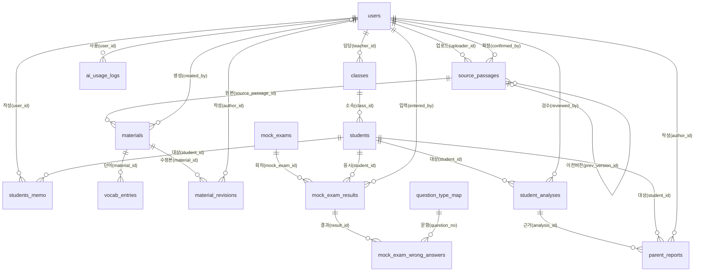

# Classon ERD

> DB: **PostgreSQL** · 실행 가능한 DDL은 [`schema.sql`](./schema.sql)
> 이 문서와 `schema.sql`은 항상 함께 수정한다. 둘이 다르면 이 문서를 기준으로 맞춘다.

## 0. 구현 규칙 (JPA / Spring Boot)

- 테이블·컬럼명은 영문 `snake_case`. 엔티티 필드는 `camelCase`로 매핑한다.
- PK: `bigint GENERATED ALWAYS AS IDENTITY` → `@GeneratedValue(strategy = GenerationType.IDENTITY)`
- 시각은 `timestamptz` → `OffsetDateTime` 또는 `Instant`. 날짜만 필요한 컬럼은 `date` → `LocalDate`
- JSON은 `jsonb` → `@JdbcTypeCode(SqlTypes.JSON)`
- enum 성격 컬럼은 DB에서 `varchar`(+ CHECK). 엔티티에서는 Java enum + `@Enumerated(EnumType.STRING)`
- 연관관계는 기본적으로 `@ManyToOne(fetch = FetchType.LAZY)` 단방향. 양방향은 필요할 때만 추가한다.
- `ON DELETE CASCADE`라고 적힌 관계만 DB에서 연쇄 삭제한다. 나머지는 삭제를 막거나(soft delete) 서비스 로직에서 처리한다.
- 학생(`students`)은 **soft delete**: 삭제 시 `deleted_at`에 현재 시각을 기록하고, 모든 조회는 `deleted_at IS NULL` 조건을 건다.

## 1. 도메인 개요

학원 강사용 플랫폼. 강사가 영어 지문을 올리면 AI가 수업 자료를 생성하고, 강사가 학생 성적을 관리하며 AI 분석을 바탕으로 학부모 리포트를 만든다.

| 영역 | 테이블 |
|---|---|
| 사용자·반·학생 | `users`, `classes`, `students`, `students_memo` |
| 자료 생성 | `source_passages` → `materials` → `vocab_entries` / `material_revisions`, `ai_usage_logs` |
| 성적 | `mock_exams`, `mock_exam_results`, `mock_exam_wrong_answers`, `question_type_map`, `word_tests_results` |
| 분석·리포트 | `student_analyses` → `parent_reports` |

## 2. 관계도

## 3. FK 목록

| 자식 테이블.컬럼 | 부모 테이블.컬럼 | 관계 | 삭제 시 |
|---|---|---|---|
| `classes.teacher_id` | `users.id` | N:1 | 제한 |
| `students.class_id` | `classes.id` | N:1 (학생은 한 반에만 속함) | 제한 |
| `students_memo.user_id` | `users.id` | N:1 | 제한 |
| `students_memo.student_id` | `students.id` | N:1 | 제한 |
| `ai_usage_logs.user_id` | `users.id` | N:1 | 제한 |
| `source_passages.uploader_id` | `users.id` | N:1 | 제한 |
| `source_passages.confirmed_by` | `users.id` | N:1 | 제한 |
| `source_passages.prev_version_id` | `source_passages.id` | N:1 (자기 참조) | 제한 |
| `materials.source_passage_id` | `source_passages.id` | N:1 | **CASCADE** |
| `materials.created_by` | `users.id` | N:1 | 제한 |
| `vocab_entries.material_id` | `materials.id` | N:1 | **CASCADE** |
| `material_revisions.material_id` | `materials.id` | N:1 | **CASCADE** |
| `material_revisions.author_id` | `users.id` | N:1 | 제한 |
| `mock_exam_results.mock_exam_id` | `mock_exams.id` | N:1 | 제한 |
| `mock_exam_results.student_id` | `students.id` | N:1 | 제한 |
| `mock_exam_results.entered_by` | `users.id` | N:1 | 제한 |
| `mock_exam_wrong_answers.result_id` | `mock_exam_results.id` | N:1 (복합 PK 일부) | 제한 |
| `mock_exam_wrong_answers.question_no` | `question_type_map.question_no` | N:1 (복합 PK 일부) | 제한 |
| `student_analyses.student_id` | `students.id` | N:1 | 제한 |
| `student_analyses.reviewed_by` | `users.id` | N:1 | 제한 |
| `parent_reports.analysis_id` | `student_analyses.id` | N:1 | 제한 |
| `parent_reports.student_id` | `students.id` | N:1 (analysis를 거쳐도 나오지만 조회 편의상 유지) | 제한 |
| `parent_reports.author_id` | `users.id` | N:1 | 제한 |

`word_tests_results`는 아직 관계가 정해지지 않았다 (5장 참고).

## 4. 테이블 명세

표기: **PK** 기본키 · **FK** 외래키 · **UK** 유니크 · NULL 열의 `N` = NULL 허용, `NN` = NOT NULL

### 4.1 `users` — 유저

강사·관리자 계정. 로그인 아이디는 선생님 이름을 쓴다. 퇴사한 선생님도 자료를 남기기 위해 삭제하지 않고 `INACTIVE`로 바꾼다.

| 컬럼 | 타입 | NULL | 키 | 설명 |
|---|---|---|---|---|
| id | bigint | NN | PK | |
| login_id | varchar | N | UK | 로그인 아이디 (선생님 이름) |
| password_hash | varchar | N | | 비밀번호 해시 |
| role | varchar | N | | `ADMIN` / `TEACHER` |
| status | varchar | N | | `ACTIVE` / `INACTIVE` |
| created_at | timestamptz | N | | 생성 시각 |

### 4.2 `classes` — 반

| 컬럼 | 타입 | NULL | 키 | 설명 |
|---|---|---|---|---|
| id | bigint | NN | PK | |
| name | varchar | N | | 반 이름 |
| teacher_id | bigint | NN | FK → users | 담당 선생님 |
| is_active | boolean | N | | 활성화 여부 |

### 4.3 `students` — 학생

성적 보존을 위해 실제 삭제 대신 `deleted_at`을 쓰는 soft delete. 보존 기간이 지나면 이름·연락처만 지운다.

| 컬럼 | 타입 | NULL | 키 | 설명 |
|---|---|---|---|---|
| id | bigint | NN | PK | |
| class_id | bigint | NN | FK → classes | 소속 반 (한 학생은 한 반에만 속함) |
| name | varchar | N | | 이름 |
| school | varchar | N | | 학교 |
| grade | varchar | N | | 학년 |
| phone | varchar | N | | 학생 연락처 |
| parent_phone | varchar | N | | 학부모 연락처 |
| status | varchar | N | | `ACTIVE` / `INACTIVE` |
| deleted_at | timestamptz | N | | 삭제 시각. NULL이면 활성 학생 |

### 4.4 `students_memo` — 학생 메모

| 컬럼 | 타입 | NULL | 키 | 설명 |
|---|---|---|---|---|
| id | bigint | NN | PK | |
| content | text | N | | 메모 내용 |
| created_at | timestamptz | N | | 작성 시각 |
| word_score | int | N | | 단어시험 점수 (5장: 저장 위치 미정) |
| user_id | bigint | NN | FK → users | 작성한 선생님 |
| student_id | bigint | NN | FK → students | 대상 학생 |

### 4.5 `source_passages` — 원본 지문

자료 생성의 출발점. 관리자 공식 원본(`OFFICIAL`)과 강사 개인 원본(`PERSONAL`)을 구분한다. 수정 시 새 행을 만들고 `prev_version_id`로 이전 버전을 가리킨다.

| 컬럼 | 타입 | NULL | 키 | 설명 |
|---|---|---|---|---|
| id | bigint | NN | PK | |
| origin | varchar | N | | `OFFICIAL` 공식 / `PERSONAL` 개인 |
| uploader_id | bigint | NN | FK → users | 지문을 올린 사용자. 개인 원본은 소유자 |
| title | varchar | N | | 자료 찾기에 표시되는 이름 |
| category | varchar | N | | 지문 종류: 모의고사 / 교과서 / 기타 |
| grade | varchar | N | | 모의고사·교과서의 학년 |
| exam_year | smallint | N | | 시행 연도 (모의고사, 예: 2022) |
| exam_month | smallint | N | | 시행 월 (모의고사, 예: 3, 6, 9) |
| publisher | varchar | N | | 출판사 (교과서, 예: 미래엔, YBM) |
| unit_label | varchar | N | | 단원 (교과서, 예: 1과) |
| passage_text | text | N | | AI에 전달하는 지문 본문 |
| file_key | varchar | N | | 업로드한 원본 파일의 저장소 경로 |
| extra_prompt | text | N | | AI 생성 방향 추가 지시. 재생성 시 재사용 |
| status | varchar | N | | `GENERATING` 생성 중 / `REVIEW` 확인 대기 / `CONFIRMED` 확정 / `FAILED` 실패 |
| confirmed_by | bigint | NN | FK → users | 확정 버튼을 누른 사용자 |
| confirmed_at | timestamptz | N | | 확정 시각. 자료 찾기 정렬 기준 |
| prev_version_id | bigint | NN | FK → source_passages | 이전 버전. 노트상 첫 버전은 NULL (5장 참고) |
| created_at | timestamptz | N | | 생성(업로드) 시각 |
| updated_at | timestamptz | N | | 마지막 수정 시각 |

### 4.6 `materials` — 생성자료

원본 지문에서 AI가 만든 자료. 원본이 삭제되면 함께 삭제된다.

| 컬럼 | 타입 | NULL | 키 | 설명 |
|---|---|---|---|---|
| id | bigint | NN | PK | |
| source_passage_id | bigint | NN | FK → source_passages (CASCADE) | 이 자료의 원본 지문 |
| created_by | bigint | N | FK → users | 자료를 만든 사용자 (5장: 컬럼명 확인) |
| material_type | varchar | N | | `vocab` 단어장 / `analysis` 지문분석서 / `lesson` 수업자료 |
| gen_status | varchar | N | | `generating` / `success` / `failed` |
| content_json | jsonb | N | | AI 생성 결과. 미리보기와 간단 수정 대상 |
| file_key | varchar | N | | 확정 시 만든 docx의 저장소 경로 |
| regen_count | int | N | | 재생성 횟수. 기본값 0 |
| is_shared | boolean | N | | 강사 개인 자료의 공유 여부. 기본값 false |
| shared_at | timestamptz | N | | 공유를 켠 시각 |
| created_at | timestamptz | N | | 생성 시각 |
| updated_at | timestamptz | N | | 마지막 수정 시각 |

### 4.7 `vocab_entries` — 단어

`material_type = vocab`인 생성자료의 단어 목록. 자료가 삭제되면 함께 삭제된다.

| 컬럼 | 타입 | NULL | 키 | 설명 |
|---|---|---|---|---|
| id | bigint | NN | PK | |
| material_id | bigint | NN | FK → materials (CASCADE) | 소속 단어장 |
| word | varchar | N | | 영어 표제어 (숙어 포함) |
| meaning | varchar | N | | 지문 속 문맥에 맞는 한글 뜻 |
| part_of_speech | varchar | N | | 품사 |
| sort_order | int | N | | 단어장 내 표시 순서 |
| created_at | timestamptz | N | | 생성 시각 |
| updated_at | timestamptz | N | | 마지막 수정 시각 |

### 4.8 `material_revisions` — 강사 수정본

공식 자료를 강사가 수정해서 올린 docx. 기준 자료가 삭제되면 함께 삭제된다.

| 컬럼 | 타입 | NULL | 키 | 설명 |
|---|---|---|---|---|
| id | bigint | NN | PK | |
| material_id | bigint | NN | FK → materials (CASCADE) | 기준이 된 공식 자료 |
| author_id | bigint | NN | FK → users | 수정본을 올린 강사 (소유자) |
| seq_no | int | N | | 같은 자료·같은 강사 기준 순번 |
| subtitle | varchar | N | | 자료 찾기에 표시되는 수정본 설명 |
| intent | text | N | | 수정 목적 설명 (선택 입력) |
| file_key | varchar | N | | 업로드한 docx의 저장소 경로 |
| original_filename | varchar | N | | 업로드 당시 파일명. 다운로드 시 사용 |
| is_shared | boolean | N | | 자료 찾기 공개 여부. 기본값 false |
| shared_at | timestamptz | N | | 공유를 켠 시각 |
| created_at | timestamptz | N | | 업로드 시각 |
| updated_at | timestamptz | N | | 마지막 수정 시각 |

### 4.9 `ai_usage_logs` — AI 사용 로그

| 컬럼 | 타입 | NULL | 키 | 설명 |
|---|---|---|---|---|
| id | bigint | NN | PK | |
| user_id | bigint | NN | FK → users | 요청한 사용자 |
| purpose | varchar | N | | `MATERIAL_GEN` 자료 생성 / `REGEN` 재생성 / `OCR_GRADING` 단어 채점 / `STUDENT_ANALYSIS` 학생 분석 |
| input_tokens | int | N | | 입력 토큰 수 |
| output_tokens | int | N | | 출력 토큰 수 |
| result | varchar | N | | `SUCCESS` / `FAILED` |
| created_at | timestamptz | N | | 생성 시각 |

### 4.10 `mock_exams` — 모의고사 회차

여러 학생이 같은 시험 정보를 공유하기 위한 테이블.

| 컬럼 | 타입 | NULL | 키 | 설명 |
|---|---|---|---|---|
| id | bigint | NN | PK | |
| exam_year | int | N | | 시행 연도 |
| exam_month | int | N | | 시행 월 |
| grade | varchar(10) | N | | 학년 |
| title | varchar(100) | N | | 표시되는 이름 |
| created_at | timestamptz | N | | 생성 시각 |
| updated_at | timestamptz | N | | 수정 시각 |

### 4.11 `mock_exam_results` — 학생 점수 등급

학생별 모의고사 점수와 등급. 원점수는 오답을 받아 계산하고, 등급은 원점수로 산출한다.

| 컬럼 | 타입 | NULL | 키 | 설명 |
|---|---|---|---|---|
| id | bigint | NN | PK | |
| mock_exam_id | bigint | NN | FK → mock_exams | 모의고사 회차 |
| raw_score | int | N | | 원점수 (오답으로 계산) |
| grade_level | int | N | | 등급 (원점수로 산출) |
| created_at | timestamptz | N | | 생성 시각 |
| updated_at | timestamptz | N | | 수정 시각 |
| student_id | bigint | NN | FK → students | 응시 학생 |
| entered_by | bigint | NN | FK → users | 성적을 입력한 강사 |

### 4.12 `question_type_map` — 문항 유형 매핑

enum처럼 쓰는 고정 테이블. 문항 번호 18~45번, 총 28행이며 추가·수정하지 않는다. 듣기 문항은 다루지 않는다.

| 컬럼 | 타입 | NULL | 키 | 설명 |
|---|---|---|---|---|
| question_no | int | NN | PK | 문항 번호 (18~45) |
| type_name | varchar(30) | N | | 문항 유형명 |

### 4.13 `mock_exam_wrong_answers` — 틀린 문항

`mock_exam_results`와 `question_type_map`의 N:M 관계를 잇는 테이블. 학생이 틀린 문항을 저장한다.

| 컬럼 | 타입 | NULL | 키 | 설명 |
|---|---|---|---|---|
| result_id | bigint | NN | PK, FK → mock_exam_results | 학생 점수 결과 |
| question_no | int | NN | PK, FK → question_type_map | 틀린 문항 번호 |

JPA: 복합키는 `@EmbeddedId` + `@MapsId`로 매핑한다.

### 4.14 `word_tests_results` — 단어시험결과

강사가 답안 스캔본을 올리면 AI가 1차 채점하고, 강사가 검수해서 2차 확정한다. **관계 미정** (5장 참고).

| 컬럼 | 타입 | NULL | 키 | 설명 |
|---|---|---|---|---|
| id | bigint | NN | PK | 결과 고유 번호 |
| batch_key | varchar | N | | 한 번에 올린 묶음 구분값 (uuid) |
| title | varchar | N | | 시험명 (예: 3월 2주차 단어시험) |
| test_date | date | N | | 시험 본 날짜. 그래프 x축 |
| total | int | N | | 전체 문항 수 |
| score | int | N | | 맞은 문항 수. AI 채점 전에는 NULL |
| status | varchar | N | | `aigrading` / `needreview` / `confirmed` |
| ai_grading | jsonb | N | | 문항별 AI 판독·정오 결과. 2차 채점 화면용 |
| scan_file_key | varchar | N | | 답안 스캔본 저장 경로. 보존 기간 후 NULL |
| scan_purged_at | varchar | N | | 스캔본 파기 시각 (5장: 타입 확인) |
| confirmed_at | timestamptz | N | | 확정 시각 |
| created_at | timestamptz | N | | 업로드 시각 |
| updated_at | timestamptz | N | | 마지막 수정 시각 |

### 4.15 `student_analyses` — 학생 분석

성적을 바탕으로 한 AI 분석. AI 초안(`AI_DRAFT`)을 강사가 검수하면 `teacher_edited`가 채워지고 `REVIEWED`가 된다. 학부모 리포트는 이 검수본으로 만든다.

| 컬럼 | 타입 | NULL | 키 | 설명 |
|---|---|---|---|---|
| id | bigint | NN | PK | |
| period_start | date | N | | 분석 시작일 |
| period_end | date | N | | 분석 종료일 |
| ai_result | jsonb | N | | AI 분석 원문 |
| teacher_edited | jsonb | N | | 강사 검수본. 검수 전엔 비어 있음 |
| status | varchar | N | | `AI_DRAFT` 초안 / `REVIEWED` 검수 완료 |
| reviewed_at | jsonb | N | | 검수 완료 시각 (5장: 타입 확인) |
| created_at | timestamptz | N | | 생성 시각 |
| updated_at | timestamptz | N | | 수정 시각 |
| student_id | bigint | NN | FK → students | 대상 학생 |
| reviewed_by | bigint | NN | FK → users | 분석을 요청·검수한 강사 |

### 4.16 `parent_reports` — 학부모 리포트

학부모에게 전달한 리포트. 완성 후에는 수정하지 않는다. 생성 시점의 `teacher_edited`를 `content_snapshot`에 복사해서 저장한다.

| 컬럼 | 타입 | NULL | 키 | 설명 |
|---|---|---|---|---|
| id | bigint | NN | PK | |
| analysis_id | bigint | NN | FK → student_analyses | 근거가 된 분석 |
| content_snapshot | jsonb | N | | 전달 시점 내용 (검수본 복사본) |
| created_at | timestamptz | N | | 생성 시각 |
| student_id | bigint | NN | FK → students | 대상 학생 |
| author_id | bigint | NN | FK → users | 리포트를 작성한 강사 |

## 5. 미정 · 확인 필요

구현할 때 아래 항목은 **임의로 바꾸지 말고 먼저 확인**한다.

| # | 대상 | 내용 |
|---|---|---|
| 1 | `word_tests_results` | 학생·반·강사와의 관계 미정. 노트에는 학생ID, 채점강사ID, 대상반ID(합동·보충시험은 NULL), 확정자ID가 언급됨. 점수를 이 테이블 / `students_memo.word_score` / 학생 테이블 중 어디에 둘지도 미정 |
| 2 | `materials.created_by` | 최신 ERD에서 추가한 소유자 컬럼의 실제 이름과 NULL 여부로 맞출 것 |
| 3 | `source_passages.prev_version_id` | NOT NULL이지만 노트상 첫 버전은 NULL. 이대로면 첫 지문을 저장할 수 없음 |
| 4 | `source_passages.confirmed_by`, `student_analyses.reviewed_by` | NOT NULL이지만 확정·검수 전에는 값이 없음 |
| 5 | `student_analyses.reviewed_at` | 타입이 jsonb (시각 컬럼이면 timestamptz가 자연스러움) |
| 6 | `word_tests_results.scan_purged_at` | 타입이 varchar (시각 컬럼이면 timestamptz가 자연스러움) |
| 7 | `students.class_id` | NOT NULL이라 반 배정 전 학생은 등록 불가 |

## 6. 변경 이력

### v0.1 — ERDCloud 초안 대비 변경점

- DB를 PostgreSQL로 전환: `LONG`→`bigint`, `datetime`→`timestamptz`, `tinyint`→`smallint`, `longtext`→`text`, `json`→`jsonb`, `enum`→`varchar`(+CHECK)
- 테이블명을 영문 물리명으로 통일
- 모든 FK를 명시 (초안 SQL에는 `mock_exam_wrong_answers`의 2개만 제약으로 내보내졌음)
- `students_memo`: 뒤바뀐 컬럼명·타입 수정 (`content text`, `created_at timestamptz`)
- 오타 수정: `intput_tokens`→`input_tokens`, `ertered_by`→`entered_by`, `AI_DRAFTR/REVIEWD`→`AI_DRAFT/REVIEWED`
- `mock_exam_wrong_answers.id`→`result_id`
- `materials.created_by` 추가 (컬럼명 확인 필요)
